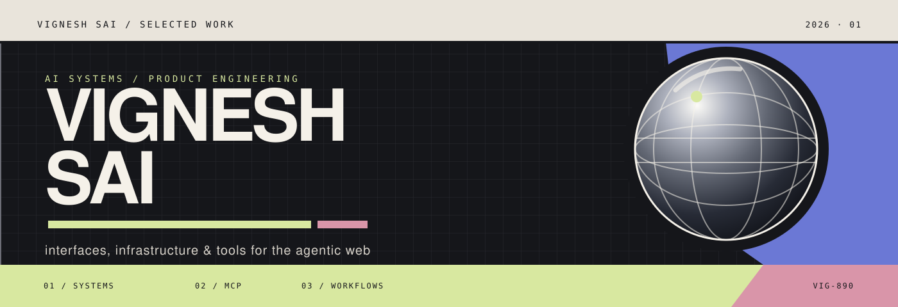
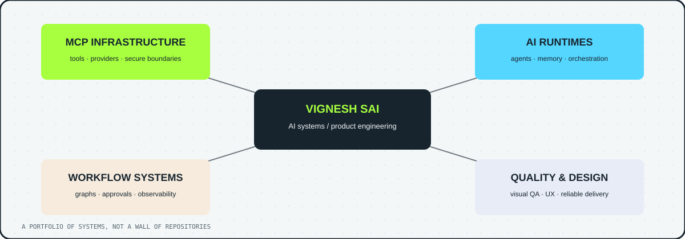

<div align="center">



</div>

<pre align="center">
╔══════════════════════════════════════════════════════════════════════╗
║  V I G N E S H   S A I  //  BUILDING THE INVISIBLE MACHINERY         ║
║  AI SYSTEMS · MCP INFRASTRUCTURE · WORKFLOW ENGINES · VISUAL QA      ║
╚══════════════════════════════════════════════════════════════════════╝
</pre>

<div align="center">

<a href="https://github.com/vigneshsai890?tab=repositories"></a>
<a href="https://github.com/vigneshsai890"></a>
<a href="https://github.com/vigneshsai890?tab=stars"></a>

</div>

## `01 / THE SHORT VERSION`

I build **AI infrastructure that feels like a product**: typed interfaces, secure boundaries, visible workflows, and documentation that makes a system legible before anyone runs it.

My public work currently clusters around:

- **MCP infrastructure** — provider adapters, tool contracts, package runners
- **AI runtime systems** — agents, memory, orchestration and execution boundaries
- **Workflow products** — graph execution, approvals and observability
- **Quality engineering** — visual regression, end-to-end testing and dependable delivery

<div align="center">



</div>

## `02 / SELECTED BUILDS`

<table>
<tr>
<td width="50%" valign="top">

### `social-mcp`
Strict MCP social tools with normalized provider contracts and a defensive X API adapter.

→ [Open project](https://github.com/vigneshsai890/social-mcp)

### `agentos`
An LLM-neutral runtime kernel for composing agent capabilities without binding the system to one model vendor.

→ [Open project](https://github.com/vigneshsai890/agentos)

### `universal-ai-memory`
Local-first memory infrastructure with encrypted payloads, blind indexes and injected adapters.

→ [Open project](https://github.com/vigneshsai890/universal-ai-memory)

</td>
<td width="50%" valign="top">

### `workflow-studio`
Directed workflow graphs with LLM, MCP-tool and human-approval nodes.

→ [Open project](https://github.com/vigneshsai890/workflow-studio)

### `mcp-cli`
A security-conscious Go CLI for installing, searching and running MCP packages.

→ [Open project](https://github.com/vigneshsai890/mcp-cli)

### `Rxplain`
Safety-focused healthcare automation testing with strong validation and accessibility checks.

→ [Open project](https://github.com/vigneshsai890/Rxplain)

</td>
</tr>
</table>

## `03 / HOW I THINK ABOUT SOFTWARE`

```text
MAKE THE BOUNDARY EXPLICIT  →  tools, data, auth and side effects should be visible
MAKE THE SYSTEM LEGIBLE      →  architecture is part of the product, not a postscript
MAKE FAILURE BORING          →  retries, validation, redaction and tests belong in the design
MAKE THE SURFACE MEMORABLE   →  the README, the diagram and the interface are one experience
```

## `04 / STACK SIGNAL`

<div align="center">


</div>

## `05 / CURRENTLY`

I am turning these experiments into a tighter public body of work: fewer “just a repo” surfaces, more **clear product narratives, architecture maps, threat boundaries, and runnable proofs**.

<div align="center">

<sub>DESIGN THE SYSTEM · NAME THE TRADE-OFF · SHIP THE PROOF</sub>

</div>

<br />

<div align="center">

<a href="https://github.com/vigneshsai890?tab=repositories">[ BROWSE THE LAB ]</a>
&nbsp;&nbsp;·&nbsp;&nbsp;
<a href="https://github.com/vigneshsai890/social-mcp">[ START WITH MCP ]</a>

</div>
